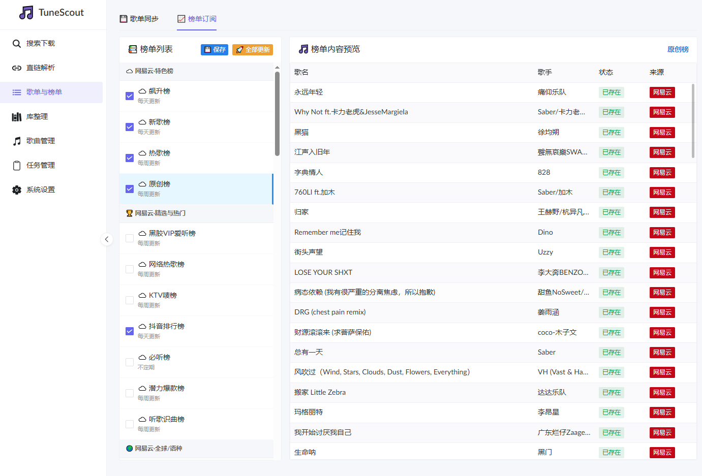
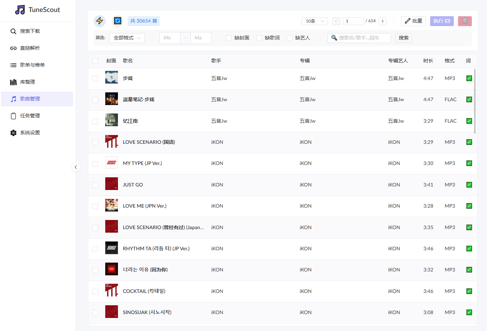
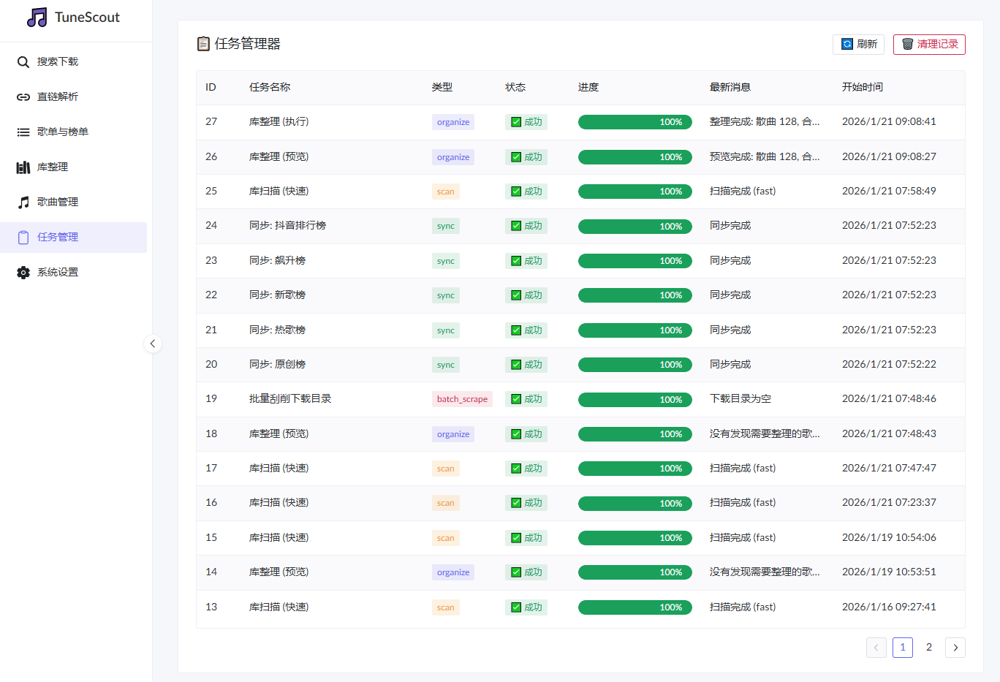

# 🎵 TuneScout

[](https://github.com/yuwancumian2009/TuneScout-v2/blob/main/更新记录.txt)

**TuneScout** 是一个一体化的本地音乐库管理与自动化工具，是 Navidrome 服务器的最佳伴侣。

通过现代化的 Web 界面完成音乐下载、元数据刮削、目录整理、歌单同步与后台任务管理，让曲库始终井井有条。



## ✨ 核心功能

* **🌐 多平台下载**
    * 支持网易云音乐、QQ音乐、酷我音乐、咪咕、酷狗、Bilibili（提取音频）与 YouTube。
    * 找不到目标版本时自动跨平台换源；优先取无损，下载后校验歌名、歌手与时长，避免下成翻唱或试听片段。
* **🏷️ 智能元数据刮削**
    * 自动补全封面、歌词、歌手、专辑、流派。
    * 标题 + 歌手双校验匹配，匹配不到就保留原标签，不再硬套第一条结果导致封面张冠李戴。
    * 批量修复缺失封面/歌词，脏标题清洗（洗板）。
* **📂 自动化库整理**
    * 统一整理为 `歌手/专辑/歌曲.ext`，散落的同名目录自动合并。
    * 多人合作曲、群星合辑单独归类，整理后清理空目录。
    * 基于歌名或「歌手 + 歌名」查重，可按体积/无损/时长保留。
* **📑 歌单与榜单同步**
    * 订阅网易云 / QQ 音乐歌单或排行榜，仅下载缺失曲目。
    * 歌单直接写入 Navidrome 数据库，无需手动导入。
    * Cron 定时同步，时区感知。
* **⚡ 任务与实时同步**
    * 下载、扫描、整理、刮削进度实时可见，运行中的任务可一键停止。
    * 下载或删除后曲库立即刷新，并同步增删 Navidrome 数据库记录，不会留下失效条目。
* **🔒 安全**
    * 所有文件操作限定在音乐目录内（路径白名单）。
    * 登录失败限流、写操作同源校验。
    * Docker Compose 一键部署。

## 📸 界面预览

### 歌曲管理
强大的筛选器（格式、时长、缺封面/缺歌词、重复项）与批量操作。


### 任务管理
任务队列与实时进度追踪，运行中的作业可以随时停止。


## 🚀 快速开始 (Docker Compose)

### 1. 准备目录

```bash
mkdir -p /path/to/tunescout && cd /path/to/tunescout
touch config.json library_cache.db
```

### 2. docker-compose.yaml

```yaml
version: '3'
services:
  tunescout:
    image: yuwancumian2009/tunescout-v2:latest
    container_name: tunescout
    environment:
      - TZ=Asia/Shanghai            # 设置时区，确保定时任务准确
      - WEB_USERNAME=admin          # Web 界面登录用户名（可选，默认 admin）
      - WEB_PASSWORD=yourpassword   # Web 界面登录密码（设置后自动开启认证）
      - ND_DB_PATH=/navidrome_data/navidrome.db
      - ND_MUSIC_PREFIX=/music
    volumes:
      - ./config.json:/app/config.json                 # 配置文件（需事先创建空文件）
      - ./library_cache.db:/app/library_cache.db       # 曲库缓存（需事先创建空文件）
      - /path/to/your/music:/music                     # 本地音乐库目录
      - /path/to/download:/download                    # 临时下载目录
      - /vol1/1000/docker/navidrome:/navidrome_data    # Navidrome 数据目录（需可写）
    ports:
      - "8503:8503"
    restart: unless-stopped
```

### 3. 访问

浏览器打开 `http://你的IP:8503`。设置了 `WEB_PASSWORD` 时会要求登录。

## ⚙️ 配置说明

可在 Web 界面的「设置」中修改，或直接编辑 `/app/config.json`。

| 配置项 | 说明 | 默认值 |
| :--- | :--- | :--- |
| `audio_quality` | 下载音质偏好（`lossless` / `high`） | `high` |
| `match_threshold` | 元数据匹配相似度阈值 | `85` |
| `leaderboard_cron` | 榜单同步 Cron | `0 2 * * 1` |
| `organize_cron` | 自动整理 Cron | `0 5 * * *` |
| `org_multi_artist_enabled` | 多人合作曲归类 | `True` |
| `auto_move_after_download` | 下载后自动归档入库 | `True` |

## 🛠️ 开发与构建

后端 FastAPI + SQLite，前端 Vue 3 + Vite + Naive UI。

```bash
# 后端
cd backend && pip install -r requirements.txt
uvicorn main:app --reload --port 8503

# 前端
cd frontend && npm install && npm run dev
```

## ⚠️ 免责声明

1. 本项目仅供个人学习、技术研究与本地音乐库整理使用。
2. 本项目不提供任何音乐文件下载服务，数据均来自公开互联网接口。
3. 请遵守当地法律法规与版权规定，严禁用于商业用途或非法传播版权内容。
4. 开发者不对使用本项目产生的任何后果负责。

---

## ☕ 请作者喝杯咖啡

<div align="center">
  <table style="border: none;">
    <tr>
      <td align="center" style="border: none;">
        <br>
        <strong>微信支付</strong>
      </td>
      <td width="50" style="border: none;"></td>
      <td align="center" style="border: none;">
        <br>
        <strong>支付宝</strong>
      </td>
    </tr>
  </table>
  <p>感谢您的支持！您的鼓励是我更新的最大动力。</p>
</div>

---
## 📈 Star History

[](https://star-history.com/#yuwancumian2009/TuneScout-v2&Date)

**TuneScout** © 2024-2026 Released under the [MIT License](LICENSE).
